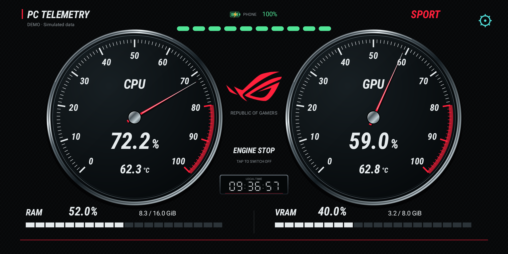
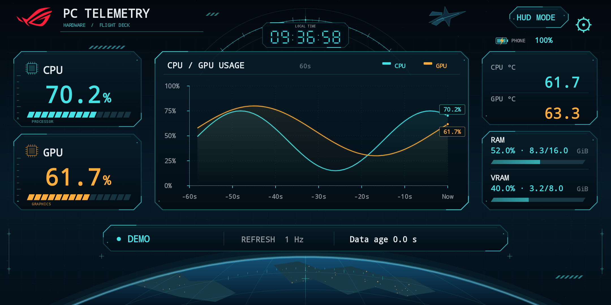
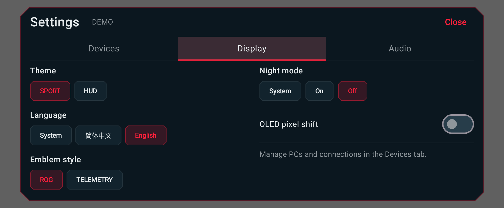
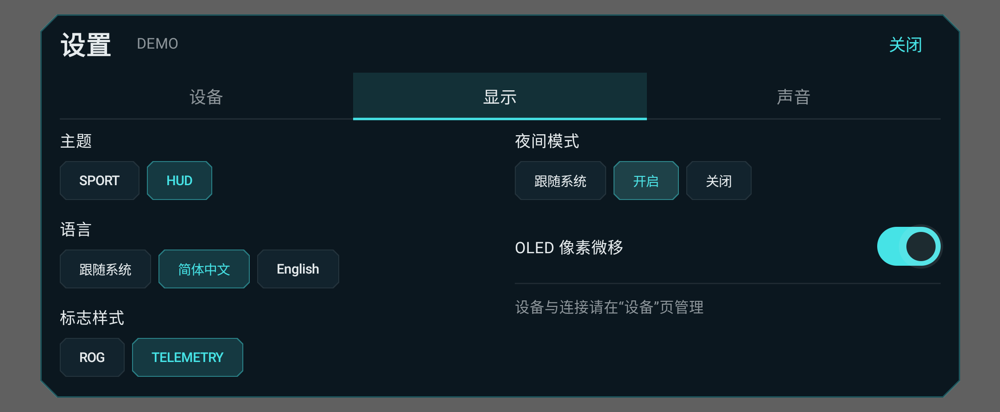
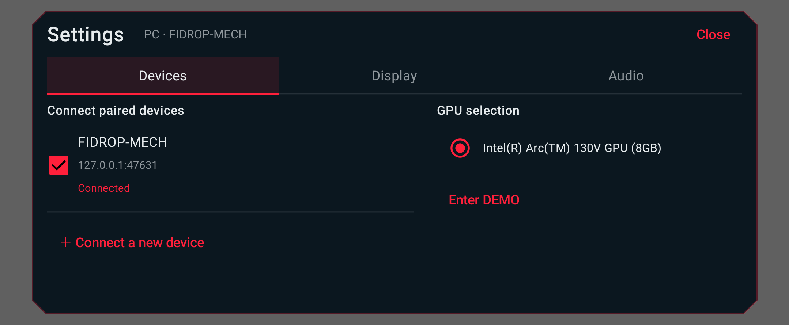
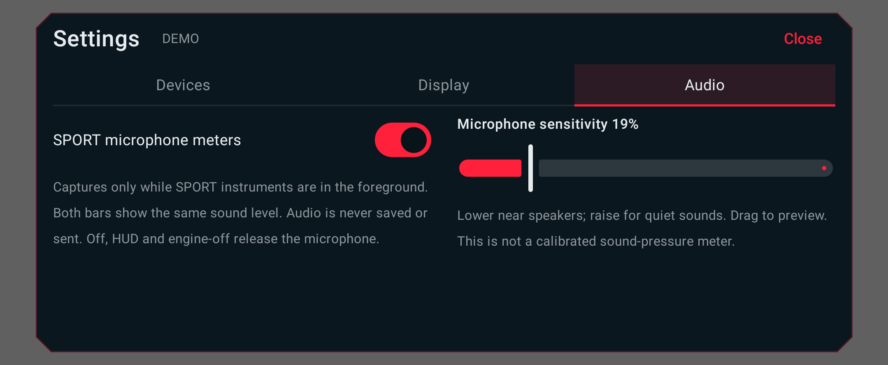

# SPORT / HUD 与分页设置优化记录

2026-11-17。Android 1.0-preview11（versionCode 11），Windows沿用1.0-preview10。

以下保留 `codex/ui-polish` 的审阅构建与测试记录。用户随后授权合并和正式发布；1.0.0的Release构建验证与交付说明见[正式发布记录](release-1.0.0.md)。

## 实现

SPORT采用多层金属表圈、方向性高光、内沿暗部、玻璃微反射、锥形红指针和金属轴心。斜纹背景改为更细、更低对比的交织纹理，保留单一中央ROG标志与原有双表结构。主读数采用等宽数字特性，缩小百分号和温度单位，辅助说明改用正体。数字按采样更新，指针独立使用320ms过渡；启动扫表仍为明确标识的显示自检。

HUD减弱次要边框、背景网格与装饰亮度，保留航电切角面板、轨道与地平线。趋势图使用原有60秒历史，增加淡填充、端点和相应读数；缺失点与超过2.5秒的采样缺口不连接、不补造数据。CPU青色、GPU橙色保持一致；右上模式标题与齿轮留出间距。

设置改为居中的切角面板，使用“设备／显示／声音”三个页签。标题、页签及关闭按钮固定；内容采用双栏，在标准字号横屏下显示选项无需滚动，窄屏或大字号可分别滚动各栏。SPORT红色强调、HUD青色强调。设备保持勾选连接方式，GPU选择和DEMO入口留在设备页；显示页保留主题、语言、标志、夜间及像素微移；声音页保留拾音开关与灵敏度。

## 保留范围

连接协议、采集指标、历史缓冲、后台行为、加密存储、配对、引擎保持时长及触感、麦克风录音生命周期均沿用原有逻辑。异常反馈不在本次优化范围：原有离线/过期/N/A、证书/认证提示及配对失败反馈继续使用。PairingDialog函数正文与修改前一致；主界面状态选择和ViewModel、core、Collector未作修改。

生成示例仅用于设计参考：[已确认示例](../design_ref/ui-polish-approved-20261117.png)。以下为原生应用在API29模拟器中的实际截图，不是生成示例。仪表演示图明确标记DEMO；真实连接图见设备联调目录。

## 实际截图

### SPORT

### HUD

### 显示设置

### 设备与声音

## 验证

- Android核心19项通过；3项需要单独提供凭据的JVM联调按原设计跳过，另有真实Windows/API29模拟器联调通过。
- 设置2项通过：三个页签、常用显示选项完整可见、关闭按钮固定、主题/语言/夜间/标志/像素微移保存与恢复；英文和中文均检查截图。截图核查后修正了底部选择项裁切与HUD右上标题碰撞。
- 主界面4项回归通过：SPORT/HUD切换、时间和电量、按住1秒启动引擎、扫表不覆盖真实遥测；另有最终完整历史截图采集通过。
- 麦克风3项通过：原生拒绝授权、原生授权后开关与灵敏度、固定PCM信号映射。检查真实AudioManager会话，在HUD/后台/引擎关闭/禁用时释放，保存灵敏度不更换会话。模拟器未启用宿主音频输入，不能据此判定实体手机拾音表现。
- 真实Windows联调1项通过：证书固定、配对、Android Keystore加密保存、同凭据勾选断开/恢复连接、连接新设备入口及远端撤销。截图使用专用回环转发地址。
- 加密档案迁移与多设备存储2项回归通过。
- Lint为0错误、28条既有警告。APK签名验证通过，与Preview9相同，可覆盖安装；安装包及源码ZIP另行校验每个条目。

## 动画测量与限制

API29软件渲染模拟器，2248×1080、density420、2核、1536MiB，各主题预热后采集15秒，日间模式、麦克风和像素微移关闭。测量使用普通Android帧时钟，不使用Compose测试时钟。

| 主题 | 帧数 | p50 | p95 | p99 | Janky frames |
| --- | ---: | ---: | ---: | ---: | ---: |
| SPORT | 352 | 20ms | 28ms | 34ms | 75.85% |
| HUD | 821 | 22ms | 30ms | 42ms | 96.83% |

原始文件为ui-polish-sport-gfxinfo.txt、ui-polish-hud-gfxinfo.txt；摘要见ui-polish-frame-summary.json。旧视觉记录p95为48/53ms，只作为历史参考，不能把不同时间的模拟器运行视为严格A/B测试。本次仍未达到60fps所需的16.7ms帧预算，不宣称流畅度验收完成。真实手机、更多比例、大系统字号及长时间运行仍待实测。

## 交付

原审阅交付为Android Preview11与PC Preview10。用户确认后将本分支纳入1.0.0，正式交付以release-1.0.0.md和GitHub v1.0.0 Release为准。
